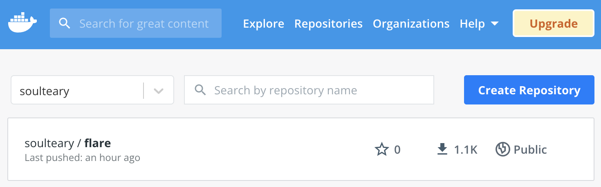
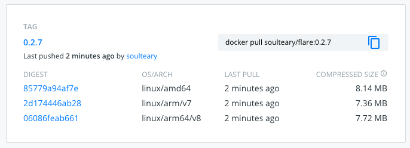
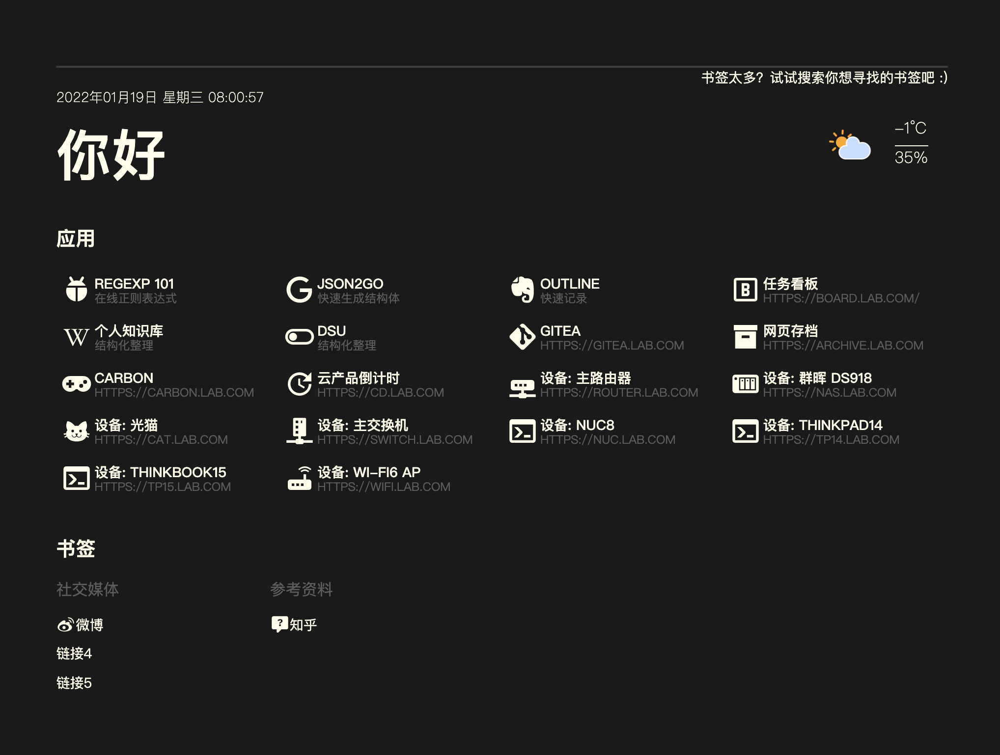
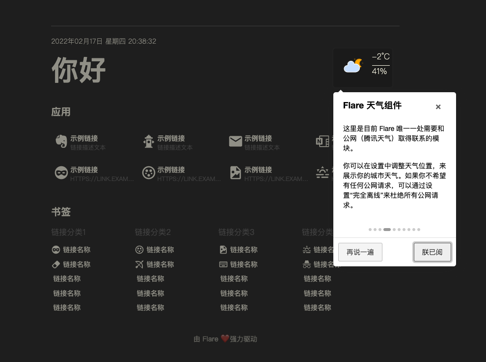
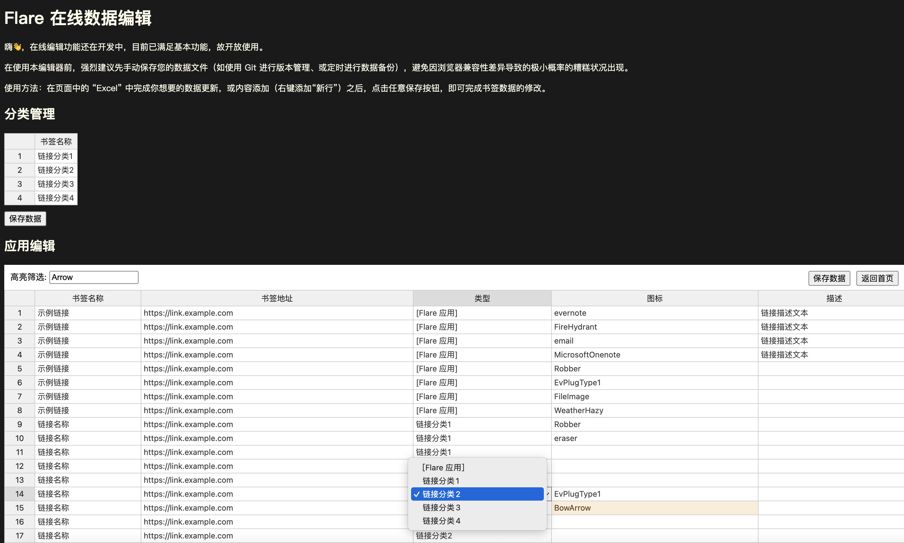
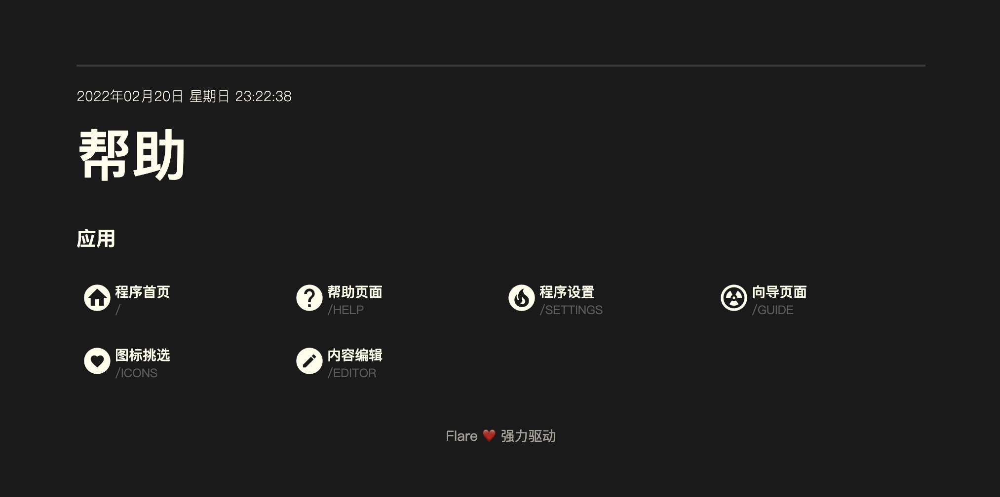
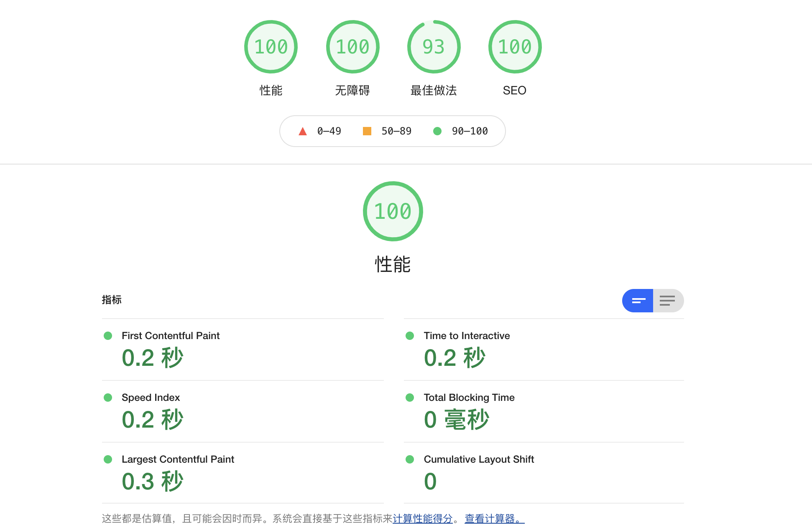
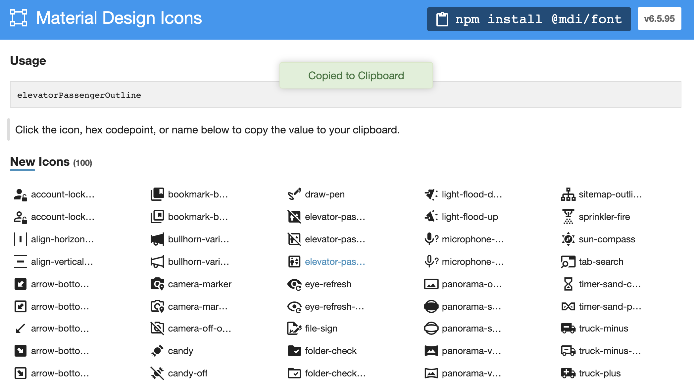

# Flare ✨

[](https://github.com/soulteary/flare/actions/workflows/codeql-analysis.yml) [](https://github.com/soulteary/flare/actions/workflows/scan.yml) [](https://github.com/soulteary/flare/actions/workflows/release.yml)  [](https://hub.docker.com/r/soulteary/flare)


如果你觉得这个项目有帮到你，欢迎点赞✨（star）给予鼓励；如果你希望收到这个项目的更新推送，可以点击关注 👀（watch）并选择适合自己的关注模式（推荐 release）。

---

轻量、快速、美观的个人导航页面，适用于 HomeLab 或其他注重私密的场景。

无任何数据库依赖，应用数据完全开放透明，100% 属于用户自己。

当前应用版本为 [Flare 0.6.4](https://github.com/soulteary/flare/releases/tag/0.6.4)。本仓库提供 Docker 部署示例和使用文档，程序源码及构建发布位于 [soulteary/flare](https://github.com/soulteary/flare)。

支持在线编辑，内置 Material Design Icons 6k+ 图标，目前累计下载过万，期待你的反馈 :)

支持 x86 以及常见的 ARM (ARM32v6、ARM32v7、ARM64v8)设备，应用资源消耗非常低：

- CPU: < 1%
- MEM: < 30M
- Docker Image: < 10M




## 快速上手

快速上手 Flare，需要两步：**下载**包含示例的代码、**启动**程序访问浏览器。

### 下载包含示例的代码

你可以使用 `git clone` 或者选择使用 “Download ZIP” 的方式，下载包含了基础的配置示例（书签和应用）的代码：

```bash
git clone https://github.com/soulteary/docker-flare.git
cd docker-flare
```

`app/*yml` 目录中包含了你的书签和应用数据，你可以根据你的需求对其进行调整。如果目录中没有配置文件，应用将在首次运行的时候，进行自动创建。

### 启动程序访问浏览器

启动应用非常简单，如果你习惯使用 Docker，可以执行：

```bash
# 可以使用最新镜像
docker pull soulteary/flare
docker run --rm -it -p 5005:5005 --log-driver local --log-opt max-size=10m --log-opt max-file=3 -v `pwd`/app:/app soulteary/flare
# 也可以追求明确，使用固定版本
docker pull soulteary/flare:0.6.4
docker run --rm -it -p 5005:5005 --log-driver local --log-opt max-size=10m --log-opt max-file=3 -v `pwd`/app:/app soulteary/flare:0.6.4
```

也可以使用 GitHub Container Registry，无需登录即可拉取：

```bash
docker pull ghcr.io/soulteary/flare:0.6.4
docker run --rm -it -p 5005:5005 --log-driver local --log-opt max-size=10m --log-opt max-file=3 -v "$(pwd)/app:/app" ghcr.io/soulteary/flare:0.6.4
```

Docker Hub 和 GHCR 提供相同 digest 的多架构镜像，均支持 `linux/amd64`、`linux/arm64`、`linux/arm/v7` 和 `linux/arm/v6`。两个镜像源都提供 `0.6.4` 固定版本和 `latest` 标签。

如果你习惯使用 Docker Compose，只需要执行：

```bash
docker compose up -d flare
```

如果你是 Traefik 用户，可以参考 [Traefik 部署示例](./example/traefik/docker-compose.yml)。

以上 Docker 命令和本仓库的 Compose 示例均使用 `local` 日志驱动，单个日志文件达到 `10m` 后轮转，最多保留 3 个日志文件。使用 `docker logs` 仍可查看日志。兼容 `json-file` 的配置、访问日志模式及现有部署的更新步骤见[日志配置与容量说明](./docs/logging.md)。

不论是哪一种方式，在命令执行完毕之后，默认情况下，我们访问浏览器的 `5005` 端口，就能看到下面的界面啦：



### 升级现有部署

0.6.4 改善移动页面布局和触摸编辑，将 HTTP 服务迁移到原生 `Fiber v3.6.1`，并将内存文件系统依赖更新到 `memfs-kit v1.1.1`。HTTP 访问日志默认只记录失败请求，可通过 `FLARE_ACCESS_LOG=errors|all|off` 或 `--access_log` 调整；启动信息和应用日志继续保留。本仓库的部署示例同步启用 Docker 日志轮转，并更新网站图标和 README 横幅。详情见 [变更记录](./CHANGELOG.md) 和 [Flare 0.6.4 发布说明](https://github.com/soulteary/flare/releases/tag/0.6.4)。

0.6.3 新增的实时时钟、秒数显示和显示时区设置继续保留。现有配置默认仍使用跟随服务器时区、包含秒数的静态显示，无需迁移。

0.6.2 的 HTTP 登录修复、浏览器书签 HTML / Flare YAML 导入导出及导入前备份继续保留。

如果反向代理终止 HTTPS、再以 HTTP 连接 Flare，请为服务设置 `FLARE_COOKIE_SECURE=true`，并始终通过 HTTPS 访问。普通 HTTP 部署无需开启该选项。

默认的 `docker-compose.yml` 使用 `soulteary/flare:latest`。先备份现有 `./app` 数据，并确认继续使用原来的 `./app:/app` 挂载；若使用命名卷，请保留原卷名和 Compose 项目名。在原部署目录中，拉取新镜像并重建同一个服务：

```bash
docker compose pull flare
docker compose up -d --force-recreate flare
docker compose exec flare flare --version
```

需要固定版本时，将 `docker-compose.yml` 中的 `image` 改为 `soulteary/flare:0.6.4`，再执行以上命令。重建会保留原来的数据挂载。日志驱动、轮转选项和 Compose 环境变量需要重建容器才生效；发布新镜像或仅执行 `docker compose restart` 都不会自动替换正在运行的旧容器。如何核对挂载及容器实际日志配置，见[日志配置与容量说明](./docs/logging.md#更新现有部署)。

Docker 日志轮转可直接用于现有镜像。`FLARE_ACCESS_LOG` 和 `--access_log` 从 0.6.4 起可用，默认值为 `errors`；需要记录普通访问时，在服务的 `environment` 中加入 `FLARE_ACCESS_LOG=all` 后重建容器。使用旧镜像前请检查版本，或运行镜像的 `flare --help` 确认支持的参数。

使用 GHCR 时，将同一个 `image` 字段改为 `ghcr.io/soulteary/flare:0.6.4`（固定版本）或 `ghcr.io/soulteary/flare:latest`（跟随最新稳定版），其余配置和升级命令相同。

如果升级后浏览器仍显示旧的图标加载结果，可强制刷新页面或清除该站点缓存。此前为绕过问题而启用的 `FLARE_MINI_REQUEST` 可以按需保留，0.6.1 起默认模式也已恢复正常。

### 日期、时间与时区

0.6.3 起，进入 **设置 → 外观 → 模块设置**，启用日期时间后，可以选择页面加载时显示或实时更新、是否显示秒数，以及跟随服务器、跟随访问设备或指定显示时区。指定时区支持搜索建议，也可以输入 `Asia/Shanghai`、`America/New_York` 等 IANA 地理时区名称或 `UTC`；修改选项时会显示预览。

未配置 `Clock` 时，继续使用跟随服务器时区、包含秒数的静态显示。选择跟随服务器时，时区通常由容器的 `TZ` 配置；显示时区设置不会修改服务器时钟、进程全局时区或天气城市。

实时显示使用**访问设备的系统时间**，再换算到所选时区；即使选择跟随服务器，也只是跟随服务器的时区。服务器或指定时区的静态显示使用服务器时间，设备时区的静态显示只在初始化时读取一次设备时间。设备时间不准会影响实时显示；此功能不会进行 NTP 校时，也不会请求外部时间接口。

禁用 JavaScript 或浏览器不支持所需时区能力时，页面会保留可读的服务端时间。配置字段、时区优先级与降级行为见[日期、时间与时区说明](https://github.com/soulteary/flare/blob/0.6.4/docs/clock.md)。

### 程序使用向导

为了方便你的使用，我制作了一个简单的向导程序，在 flare 启动之后，你可以随时访问 `/guide`，获取 flare 基础界面功能的介绍。




## 程序在线编辑页面

为了满足随时随地编辑的需求，程序新增了“在线编辑”的页面。



工具页面地址：`/editor`

0.6.2 起，可在编辑器中选择「导入 / 导出浏览器书签与 Flare YAML」，预览后合并导入 Chrome、Edge、Firefox 等浏览器导出的书签 HTML，或 Flare YAML；也可导出 HTML / YAML 和下载最近一次导入前备份。

导入支持 UTF-8、最大 8 MiB 的文件。备份位于工作目录下的 `.flare-bookmark-backups/`；使用默认 Docker / Compose 部署时，容器中的路径是 `/app/.flare-bookmark-backups/`，对应宿主机的 `./app/.flare-bookmark-backups/`，现有的 `./app:/app` 挂载已包含该目录。自定义工作目录时，请一并持久化其中的备份目录。YAML 合并导入不等于完整配置恢复。详见 [书签迁移说明](https://github.com/soulteary/flare/blob/0.6.4/docs/bookmark-transfer.md)。

## 程序帮助页面

为了减少不必要的地址记忆负担，程序新增了一个“帮助页面”，默认展示所有的程序内的工具页面。



工具页面地址：`/help`

## 程序性能

“快”作为 Flare 对主要优势而言，自然是需要“满分”来加持。



0.6.4 的 Fiber 迁移、测试条件与性能取舍见[性能记录](https://github.com/soulteary/flare/blob/0.6.4/docs/performance.md)。其中的历史实验关闭了访问日志，不能直接作为所有部署的性能保证。

如果你好奇这是如何实现的，可以阅读这篇文章：[《Flare 制作记录：应用前后端性能优化》](https://soulteary.com/2022/01/19/flare-production-record-application-frontend-and-backend-performance-optimization.html)。

## 进阶文档

- [自定义启动参数](./docs/advanced-startup.md)
- [日志配置与 Docker 日志容量](./docs/logging.md)
- [关闭免登陆模式后，如何设置用户账号](./docs/application-account.md)
- [如何挑选和使用图标](./docs/material-design-icons.md)
- [日期、时间与时区](https://github.com/soulteary/flare/blob/0.6.4/docs/clock.md)
- [如何和 Traefik 一起使用](https://github.com/soulteary/traefik-example)

## 相比较 Flame

- 服务资源消耗极低，可以跑在任何规格的机器上，甚至是一台搭载2015年S805芯片的ARM盒子。
- 程序页面性能非常好，渲染速度更快，支持同时渲染大量（数千）书签，而不必担心风扇起飞。
- 使用声明的配置来进行导航内容的管理，无需担心数据迁移问题。
- 简化了天气数据的获取方式，不再需要申请天气网站的 `API_KEY` ，避免了不必要的成本开销。
- 简化了 Flame 中的K8S、Docker 集成等不必要的功能。
- 内置了大量风格统一、高质量的矢量图标，减少选择困难症，确保界面长期“耐看”。
- 默认使用免登陆模式，避免 HomeLab、本地使用的用户有额外的登陆操作。

## 关于内置图标

程序内置了目前 [materialdesignicons.com](https://materialdesignicons.com/) 中所有的 Material Design Icons，你可以让你的每一个书签都拥有风格统一、高质量的矢量图标。



更多信息，可以参考 [如何挑选和使用图标](./docs/material-design-icons.md)。

## TODO

- [ ] 持续完善程序定制化功能
- [ ] 支持使用 API 进行内容管理
- [ ] 支持自定义主题配色

## Thanks

Inspired by https://github.com/pawelmalak/flame
